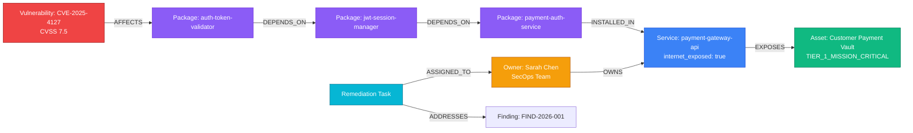

# ChainSentry 🛡️⚡
> **Don't just find vulnerabilities. Find the chain that makes them dangerous.**

**WeMakeDevs × FalkorDB Graph Hacks Hackathon Submission**  
**Track:** *Agents That Act on Connected Data*

[](https://fastapi.tiangolo.com)
[](https://www.falkordb.com/)
[](https://react.dev/)
[](https://docs.pytest.org/)

---

## 1. Problem Statement

Security scanners flood engineering teams with hundreds of vulnerability alerts. However:
- **CVSS is context-blind:** A CVSS 9.8 flaw in an isolated offline testing script receives critical alarms, while a CVSS 7.5 vulnerability sitting 2 transitive hops deep inside an internet-facing payment gateway exposing cardholder data gets ignored.
- **Transitive blindness:** Modern applications consist of deep software supply chains. Vulnerabilities rarely reside in top-level code; they sit multiple layers down in transitive dependencies.
- **Remediation paralysis:** Security teams struggle to determine *who* owns the affected service, *what* business asset is actually at risk, and *which* action to take first.

---

## 2. Solution Overview

**ChainSentry** is a graph-native AI security investigation platform powered by **FalkorDB**. 

Instead of treating vulnerabilities as isolated table rows, ChainSentry constructs an interconnected knowledge graph spanning:
`Vulnerabilities` ➔ `Packages` ➔ `Transitive Dependencies` ➔ `Services` ➔ `Business Assets` ➔ `Engineering Owners`

When an alert is received, the ChainSentry Investigation Agent traverses the graph using parameterized **Cypher queries**, discovers the attack blast radius, computes an explainable **Contextual Risk Score (0–100)**, recommends targeted mitigations, and creates audit-logged remediation tasks assigned directly to the responsible team.



---

## 3. Why FalkorDB is Essential

ChainSentry cannot exist on relational databases or document stores. Graph traversals with Cypher are fundamentally required because:

1. **Arbitrary-Depth Transitive Chains:** Traversing supply chain dependencies (`-[:DEPENDS_ON*0..4]->`) and service deployments requires graph pattern matching. Doing recursive joins in SQL across 5 entities causes performance degradation.
2. **Blast Radius Computation in Milliseconds:** FalkorDB's GraphBLAS linear-algebra matrix engine allows ChainSentry to evaluate multi-hop reachability in sub-milliseconds.
3. **Live Graph Mutation:** During security triage, an engineer can isolate a service from the public network. ChainSentry mutates the relationship property in FalkorDB, and the graph traversal immediately re-evaluates the contextual risk across all affected findings.

---

## 4. Key Cypher Queries

### Multi-Hop Attack Path Discovery
```cypher
MATCH (f:Finding {id: $finding_id})-[:ABOUT]->(v:Vulnerability)-[:AFFECTS]->(p1:Package)
MATCH path = (p1)-[:DEPENDS_ON*0..4]->(p2:Package)-[:INSTALLED_IN]->(s:Service)-[:EXPOSES]->(a:Asset)
OPTIONAL MATCH (o:Owner)-[:OWNS]->(s)
RETURN path, s.name AS svc_name, s.internet_exposed AS exposed, 
       a.name AS asset_name, a.criticality AS crit, 
       collect(DISTINCT o.name) AS owners
```
*Accomplishes:* Traces the complete dependency and service chain from the vulnerable package to downstream production assets and identifies responsible owners.

### Idempotent Entity Merge & Relationship Linking
```cypher
MERGE (v:Vulnerability {id: $cve_id})
ON CREATE SET v.title = $title, v.severity = $severity, v.cvss_score = $cvss
MERGE (p:Package {name: $pkg_name})
MERGE (v)-[:AFFECTS]->(p)
```
*Accomplishes:* Seeds and updates security entities idempotently without duplicate records.

### Live Network Perimeter Mutation
```cypher
MATCH (s:Service {name: $service_name})
SET s.internet_exposed = $internet_exposed
RETURN s.name, s.internet_exposed
```
*Accomplishes:* Demonstrates real-time risk reduction by isolating services directly in the graph.

---

## 5. Contextual Risk Scoring Model

ChainSentry normalizes risk into an explainable **0–100 scale** using 5 weighted graph factors:

$$\text{Contextual Risk} = C_{\text{CVSS}} + C_{\text{Exploit}} + C_{\text{Exposure}} + C_{\text{Criticality}} + C_{\text{Reachability}}$$

| Factor | Weight | Evaluation Criteria |
| :--- | :---: | :--- |
| **Base CVSS / Severity** | **30%** | Normalized from CVSS 0.0–10.0 score |
| **Exploit Intelligence** | **20%** | Active Exploit Proof (+20), PoC Available (+12), None (+0) |
| **Internet Perimeter Exposure** | **25%** | Service reachable via Public Internet (+25), Internal only (+5) |
| **Business Asset Criticality** | **15%** | Tier-1 Mission Critical (+15), Tier-2 (+10), Tier-3 (+5), Tier-4 (+2) |
| **Graph Reachability Breadth** | **10%** | Direct hop ≤ 2 (+10), Transitive depth 3–4 (+7), Deep > 4 (+4) |

> [!NOTE]
> **Heuristic Notice:** This score is an explainable prioritization heuristic derived from structural graph reachability, asset value, and network exposure. It ranks workload attention and does not claim guaranteed cryptographic exploitability.

---

## 6. The Core Differentiator Demonstration

ChainSentry solves the classic security triage dilemma:

| Finding | Vulnerability | Base CVSS | Graph Context | Contextual Risk |
| :--- | :--- | :---: | :--- | :---: |
| **FIND-2026-001** | `CVE-2025-4127` | **7.5 (High)** | 2 hops deep ➔ `payment-gateway-api` (Internet-Exposed) ➔ Tier-1 `Customer Payment Vault` | **86.5 / 100 (Escalated to P0)** |
| **FIND-2026-002** | `CVE-2025-9921` | **9.8 (Critical)** | Direct dependency ➔ `internal-nightly-analytics` (Staging, Offline) ➔ Tier-4 `Archived CI Logs` | **58.4 / 100 (De-escalated)** |

*Result:* By traversing connected data in FalkorDB, the team knows to fix `FIND-2026-001` first, avoiding a false-alarm fire drill on `FIND-2026-002`.

---

## 7. AI Investigation Agent & Fixed Tool Catalogue

To guarantee safety, determinism, and zero hallucination, the agent operates over a strict catalogue of typed, validated backend tools:

- `list_findings()`: Cypher query to retrieve all findings.
- `get_vulnerability_context(finding_id)`: Resolves CVE intelligence.
- `trace_dependency_paths(finding_id)`: Executes multi-hop Cypher path traversal.
- `find_affected_assets(finding_id)`: Discovers connected business assets.
- `find_responsible_owners(finding_id)`: Matches `:OWNS` relationships.
- `calculate_contextual_risk(finding_id)`: Computes 5-factor breakdown.
- `create_remediation_task(finding_id, title, priority, assigned_to)`: Commits task to FalkorDB.
- `get_investigation_history()`: Retrieves audit log of prior sessions.

> **Zero Key Requirement:** ChainSentry contains a 100% deterministic graph reasoning engine. If no LLM key is configured, it produces structured, evidence-backed reports with zero external dependencies.

---

## 8. Prerequisites & Quickstart

### Prerequisites
- Python 3.11+ or 3.12+
- Node.js 18+ or 20+
- (Optional) Docker for running FalkorDB container

### Option A: Running with Docker Compose (Recommended)
```bash
docker compose up -d
```
Access the application:
- **Frontend Dashboard:** [http://localhost:5173](http://localhost:5173)
- **FastAPI Documentation:** [http://localhost:8000/docs](http://localhost:8000/docs)

### Option B: Local Development Setup

#### 1. Start FalkorDB (via Docker or FalkorDB Cloud)
```bash
docker run -p 6379:6379 -it --rm falkordb/falkordb:latest-alpine
```

#### 2. Setup & Start Backend
```bash
cd backend
python -m venv .venv
# On Windows:
.venv\Scripts\activate
# On Linux/macOS:
source .venv/bin/activate

pip install -r requirements.txt
python seed.py
uvicorn app.main:app --reload --port 8000
```

#### 3. Setup & Start Frontend
```bash
cd ../frontend
npm install
npm run dev
```

---

## 9. Testing & Verification

Run the comprehensive pytest suite:
```bash
cd backend
.venv\Scripts\python -m pytest tests/test_chainsentry.py -v
```

All 8 automated tests verify:
- FalkorDB health endpoint and graph connectivity
- Dashboard metrics calculation from graph data
- Contextual risk sorting
- Multi-hop Cypher path traversal
- Core differentiator contrast (`FIND-2026-001` vs `FIND-2026-002`)
- Investigation agent execution & history persistence
- Remediation task lifecycle (creation and status updates)
- Live graph exposure mutation (`payment-gateway-api` risk drop)

---

## 10. AI-Assisted Development Disclosure

In accordance with competition rules:
- **Development Tool:** Antigravity AI IDE (Google DeepMind).
- **Contributions by Agent:** Code generation, Cypher query design, Pydantic schemas, React UI components, automated pytest tests, and documentation.
- **Human Guidance & Review:** Prompt engineering, architecture validation, track selection, and verification.

---

## 11. Links
- **Demo Video:** `[Add Demo Video Link Here]`
- **Repository:** https://github.com/Harshitchandel20/ChainSentry
- **Submission Track:** Agents That Act on Connected Data